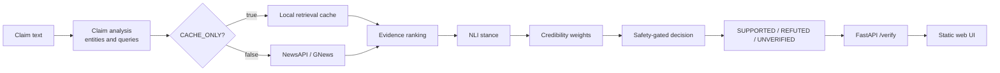

# VeriNews

A real-time, evidence-based news claim verification prototype built with Python
and FastAPI.

Given a claim, VeriNews extracts entities, retrieves recent news, ranks evidence,
runs a pretrained NLI model, weights sources by credibility, and returns
`SUPPORTED`, `REFUTED`, or `UNVERIFIED` with the evidence behind the result.

Status: Phase 7 - API and web demo. The decision engine is tagged
`v0.6-decision`.

## What it does

- Turns a free-text claim into search queries.
- Reads cached evidence or retrieves recent coverage from news providers.
- Ranks articles by relevance and recency.
- Scores each article as `SUPPORTS`, `REFUTES`, or `NEUTRAL` against the claim.
- Applies source credibility and safety gates before deciding.
- Returns `UNVERIFIED` when the evidence is missing, weak, conflicting, or too
  one-sided to decide.
- Serves a one-file web page with a claim box, verdict badge, confidence bar,
  explanation, and evidence cards.

## Architecture



## How to run

All commands below are for Windows Command Prompt (`cmd.exe`).

### 1. Open a command prompt at the project root

```cmd
cd /d "C:\path\to\verinews"
```

### 2. Create and activate the virtual environment

First time:

```cmd
python -m venv venv
venv\Scripts\activate.bat
python -m pip install -r requirements.txt
```

Later sessions:

```cmd
venv\Scripts\activate.bat
```

### 3. Run the server in demo mode

Demo mode uses only the local retrieval cache and never calls a live news
provider.

```cmd
set CACHE_ONLY=true
python -m uvicorn app.main:app --host 127.0.0.1 --port 8000
```

Or run the batch file from the project root:

```cmd
run_demo.bat
```

Open `http://127.0.0.1:8000` in a browser.

### 4. Run the server in live mode

Live mode retrieves current coverage from the configured news providers.

```cmd
set CACHE_ONLY=false
python -m uvicorn app.main:app --host 127.0.0.1 --port 8000
```

Open `http://127.0.0.1:8000` in a browser.

### 5. Run the offline claim demo without the server

```cmd
python scripts/run_demo_cache.py --split dev
```

Use `--split all` to run all 30 claims, or `--limit 5` for a short run.

### 6. Run the tests

```cmd
python -m pytest -q
```

### 7. Run the dev evaluation

```cmd
python scripts/evaluate.py --split dev
```

This writes:

- `results/eval_dev.json`
- `results/eval_dev_report.md`

The report includes exact accuracy, per-class precision and recall, the 3x3
confusion matrix, wrong-verdict rate, coverage, latency, every mistake with its
evidence, and the credibility ablation.

The evaluation script accepts `--split test` for the held-out run. Do not run
that split until the final test evaluation is scheduled.

## API

```text
POST /verify   {"claim": "A claim to check."}
GET  /health
GET  /         static web page
```

`POST /verify` accepts 1 to 500 characters. An empty or overlong claim returns
HTTP 422. A valid request returns HTTP 200 with a verdict, including
`UNVERIFIED` when the evidence is not enough.

## Limitations

- Free-tier news APIs have delay and quotas. Live coverage may lag, and the daily
  request cap can stop retrieval.
- The pipeline is English only.
- The credibility list is hand-made and small. Unknown domains receive a default
  low score.
- The NLI model is strict on partial claims. A snippet that only partially
  supports a claim can be scored neutral or refuted.
- Compound claims are hard. The Panama earthquake claim is mostly true but adds a
  false canal sentence, so the whole claim cannot be treated as supported.
- The ISOT baseline measures writing style, not factual truth.
- The dev set has only 10 claims. Its metrics are useful for diagnosis, not for a
  final estimate of real-world accuracy.
- Cache-only mode replays stored evidence. It cannot detect stories that are
  newer than the cache.
- VeriNews is a prototype, not a replacement for human fact-checking.
