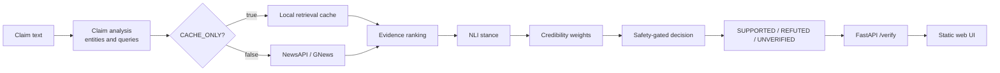

# VeriNews

A real-time, evidence-based news claim verification prototype built with Python
and FastAPI.

Given a claim, VeriNews extracts entities, retrieves recent news, ranks evidence,
runs a pretrained NLI model, weights sources by credibility, and returns
`SUPPORTED`, `REFUTED`, or `UNVERIFIED` with the evidence behind the result.

Status: v1.0. The system was frozen at tag `v0.8-frozen` before the single
held-out test run.

## What it does

- Turns a free-text claim into search queries.
- Reads cached evidence or retrieves recent coverage from news providers.
- Ranks articles by relevance and recency.
- Scores each article as `SUPPORTS`, `REFUTES`, or `NEUTRAL` against the claim.
- Applies source credibility and safety gates before deciding.
- Returns `UNVERIFIED` when the evidence is missing, weak, conflicting, or too
  one-sided to decide.
- Serves a one-file web page with a claim box, verdict badge, confidence bar,
  explanation, and evidence cards.

## Architecture



## How to run

All commands below are for Windows Command Prompt (`cmd.exe`).

### 1. Open a command prompt at the project root

```cmd
cd /d "C:\path\to\verinews"
```

### 2. Create and activate the virtual environment

First time:

```cmd
python -m venv venv
venv\Scripts\activate.bat
python -m pip install -r requirements.txt
```

Later sessions:

```cmd
venv\Scripts\activate.bat
```

### 3. Run the server in demo mode

Demo mode uses only the local retrieval cache and never calls a live news
provider.

```cmd
set CACHE_ONLY=true
python -m uvicorn app.main:app --host 127.0.0.1 --port 8000
```

Or run the batch file from the project root:

```cmd
run_demo.bat
```

Open `http://127.0.0.1:8000` in a browser.

Offline demo data: the `.cache/` folder is not tracked in git. Restore it from a
backup before running demo mode. Without `.cache/`, cache-only retrieval finds no
articles and the pipeline returns `UNVERIFIED` with a no-evidence explanation
instead of crashing.

### 4. Run the server in live mode

Live mode retrieves current coverage from the configured news providers.

```cmd
set CACHE_ONLY=false
python -m uvicorn app.main:app --host 127.0.0.1 --port 8000
```

Open `http://127.0.0.1:8000` in a browser.

### 5. Run the offline claim demo without the server

```cmd
python scripts/run_demo_cache.py --split dev
```

Use `--split all` to run all 30 claims, or `--limit 5` for a short run.

### 6. Run the tests

```cmd
python -m pytest -q
```

The test suite uses local fixtures and does not need `.cache/`.

### 7. Run the dev evaluation

```cmd
python scripts/evaluate.py --split dev
```

This writes:

- `results/eval_dev.json`
- `results/eval_dev_report.md`

The report includes exact accuracy, per-class precision and recall, the 3x3
confusion matrix, wrong-verdict rate, coverage, latency, every mistake with its
evidence, and the credibility ablation.

The evaluation script also accepts `--split test`. The held-out test split was
run once after the `v0.8-frozen` tag. Its outputs are
`results/eval_test.json` and `results/eval_test_report.md`.

## Results

The system was frozen at tag `v0.8-frozen` before the single held-out test run.
No ranking, NLI, credibility, or decision code was changed after seeing the test
results.

### Dev split

| Metric | Value |
| --- | ---: |
| Claims | 10 |
| Exact accuracy | 0.800 (8/10) |
| Wrong-verdict rate | 0.000 (0/6) |
| Coverage | 0.667 (4/6) |
| Mean latency | 4153 ms |
| Max latency | 6265 ms |

| Class | Precision | Recall | Gold support | Predicted |
| --- | ---: | ---: | ---: | ---: |
| SUPPORTED | 1.000 | 0.667 | 3 | 2 |
| REFUTED | 1.000 | 0.667 | 3 | 2 |
| UNVERIFIED | 0.667 | 1.000 | 4 | 6 |

| Expected \ Predicted | SUPPORTED | REFUTED | UNVERIFIED |
| --- | ---: | ---: | ---: |
| SUPPORTED | 2 | 0 | 1 |
| REFUTED | 0 | 2 | 1 |
| UNVERIFIED | 0 | 0 | 4 |

### Test split

| Metric | Value |
| --- | ---: |
| Claims | 20 |
| Exact accuracy | 0.600 (12/20) |
| Wrong-verdict rate | 0.071 (1/14) |
| Coverage | 0.500 (7/14) |
| Mean latency | 4692 ms |
| Max latency | 7899 ms |

| Class | Precision | Recall | Gold support | Predicted |
| --- | ---: | ---: | ---: | ---: |
| SUPPORTED | 1.000 | 0.143 | 7 | 1 |
| REFUTED | 0.833 | 0.714 | 7 | 6 |
| UNVERIFIED | 0.462 | 1.000 | 6 | 13 |

| Expected \ Predicted | SUPPORTED | REFUTED | UNVERIFIED |
| --- | ---: | ---: | ---: |
| SUPPORTED | 1 | 1 | 5 |
| REFUTED | 0 | 5 | 2 |
| UNVERIFIED | 0 | 0 | 6 |

The 8 test mistakes break down as: NLI too strict 4, retrieval miss 3, compound
claim 1, single-article gate 0, and other 0. Full evidence for every mistake is
in `results/eval_test_report.md` and `results/eval_test.json`.

### Credibility ablation

| Split | Real tiers | All weights 1.0 | Changed |
| --- | --- | --- | ---: |
| Dev | 0.800 (8/10), 0.000 (0/6), 0.667 (4/6) | 0.800 (8/10), 0.000 (0/6), 0.667 (4/6) | 0 |
| Test | 0.600 (12/20), 0.071 (1/14), 0.500 (7/14) | 0.650 (13/20), 0.071 (1/14), 0.571 (8/14) | 1 |

The single test ablation change was Tesla, which moved from `UNVERIFIED` to
`REFUTED` with all weights set to 1.0. That change was right for the wrong
reason: the two `REFUTES` came from off-topic articles about Anthropic and
iPhones, not Tesla. It is not evidence for or against the credibility weights.

## API

```text
POST /verify   {"claim": "A claim to check."}
GET  /health
GET  /         static web page
```

`POST /verify` accepts 1 to 500 characters. An empty or overlong claim returns
HTTP 422. A valid request returns HTTP 200 with a verdict, including
`UNVERIFIED` when the evidence is not enough.

## Limitations

- Free-tier news APIs have delay and quotas. Live coverage may lag, and the daily
  request cap can stop retrieval.
- The pipeline is English only.
- The credibility list is hand-made and small. Unknown domains receive a default
  low score.
- The NLI model is strict on multi-fact claims. A snippet that only partially
  supports a compound claim can be scored neutral or refuted.
- The system can confuse different events of the same type. In the West Indies
  second T20I test claim, retrieval returned articles about the first, third, and
  fourth matches in the same series.
- The NLI model can treat numbers about a different quantity as a contradiction.
  In the TSMC test claim, revenue figures were scored as refuting a net-profit
  claim.
- Retrieval can return previews, how-to-watch pages, or live blogs instead of a
  final report. The Bayern Munich vs Arsenal test claim is an example.
- Off-topic evidence can pass `REL_MIN`. In the Tesla test claim, articles about
  Anthropic and iPhones had relevance above the threshold, although the total
  weight stayed below `MIN_TOTAL_WEIGHT`.
- Compound claims are hard. The Panama earthquake claim is mostly true but adds a
  false canal sentence, so the whole claim cannot be treated as supported.
- The ISOT baseline measures writing style, not factual truth.
- The labeled sets are small: 10 dev claims and 20 test claims. The metrics are
  useful for diagnosis, not for a final estimate of real-world accuracy.
- Cache-only mode replays stored evidence. It cannot detect stories that are
  newer than the cache.
- VeriNews is a prototype, not a replacement for human fact-checking.

Author:
Ankit Negi

GithuB:https://github.com/ankitnegi-dev

PortfoliO:https://ankit-negi.is-a.dev
