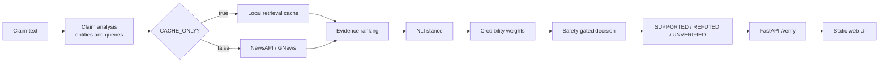

# VeriNews

A real-time, evidence-based news claim verification prototype built with Python
and FastAPI.

Given a claim, VeriNews extracts entities, retrieves recent news, ranks evidence,
runs a pretrained NLI model, weights sources by credibility, and returns
`SUPPORTED`, `REFUTED`, or `UNVERIFIED` with the evidence behind the result.

Status: v1.0. The system was frozen at tag `v0.8-frozen` before the single
held-out test run.

## What it does

- Turns a free-text claim into search queries.
- Reads cached evidence or retrieves recent coverage from news providers.
- Ranks articles by relevance and recency.
- Scores each article as `SUPPORTS`, `REFUTES`, or `NEUTRAL` against the claim.
- Applies source credibility and safety gates before deciding.
- Returns `UNVERIFIED` when the evidence is missing, weak, conflicting, or too
  one-sided to decide.
- Serves a one-file web page with a claim box, verdict badge, evidence margin bar,
  explanation, and evidence cards.

## Architecture



## How to run

All commands below are for Windows Command Prompt (`cmd.exe`).

### 1. Open a command prompt at the project root

```cmd
cd /d "C:\path\to\verinews"
```

### 2. Create and activate the virtual environment

First time:

```cmd
python -m venv venv
venv\Scripts\activate.bat
python -m pip install -r requirements.txt
```

Later sessions:

```cmd
venv\Scripts\activate.bat
```

### 3. Run the server in demo mode

Demo mode uses only the local retrieval cache and never calls a live news
provider.

```cmd
set CACHE_ONLY=true
python -m uvicorn app.main:app --host 127.0.0.1 --port 8000
```

Or run the batch file from the project root:

```cmd
run_demo.bat
```

Open `http://127.0.0.1:8000` in a browser.

Offline demo data: the `.cache/` folder is not tracked in git. Restore it from a
backup before running demo mode. Without `.cache/`, cache-only retrieval finds no
articles and the pipeline returns `UNVERIFIED` with a no-evidence explanation
instead of crashing.

### 4. Run the server in live mode

Live mode retrieves current coverage from the configured news providers.

```cmd
set CACHE_ONLY=false
python -m uvicorn app.main:app --host 127.0.0.1 --port 8000
```

Open `http://127.0.0.1:8000` in a browser.

### 5. Run the offline claim demo without the server

```cmd
python scripts/run_demo_cache.py --split dev
```

Use `--split all` to run all 30 claims, or `--limit 5` for a short run.

### 6. Run the tests

```cmd
python -m pytest -q
```

The test suite uses local fixtures and does not need `.cache/`.

### 7. Run the dev evaluation

```cmd
python scripts/evaluate.py --split dev
```

This writes:

- `results/eval_dev.json`
- `results/eval_dev_report.md`

The report includes exact accuracy, per-class precision and recall, the 3x3
confusion matrix, wrong-verdict rate, coverage, latency, every mistake with its
evidence, and the credibility ablation.

The evaluation script also accepts `--split test`. The held-out test split was
run once after the `v0.8-frozen` tag. Its outputs are
`results/eval_test.json` and `results/eval_test_report.md`.

## Results

The system was frozen at tag `v0.8-frozen` before the single held-out test run.
No ranking, NLI, credibility, or decision code was changed after seeing the test
results.

### Dev split

| Metric | Value |
| --- | ---: |
| Claims | 10 |
| Exact accuracy | 0.800 (8/10) |
| Wrong-verdict rate | 0.000 (0/6) |
| Coverage | 0.667 (4/6) |
| Mean latency | 4153 ms |
| Max latency | 6265 ms |

| Class | Precision | Recall | Gold support | Predicted |
| --- | ---: | ---: | ---: | ---: |
| SUPPORTED | 1.000 | 0.667 | 3 | 2 |
| REFUTED | 1.000 | 0.667 | 3 | 2 |
| UNVERIFIED | 0.667 | 1.000 | 4 | 6 |

| Expected \ Predicted | SUPPORTED | REFUTED | UNVERIFIED |
| --- | ---: | ---: | ---: |
| SUPPORTED | 2 | 0 | 1 |
| REFUTED | 0 | 2 | 1 |
| UNVERIFIED | 0 | 0 | 4 |

### Test split

| Metric | Value |
| --- | ---: |
| Claims | 20 |
| Exact accuracy | 0.600 (12/20) |
| Wrong-verdict rate | 0.071 (1/14) |
| Coverage | 0.500 (7/14) |
| Mean latency | 4692 ms |
| Max latency | 7899 ms |

| Class | Precision | Recall | Gold support | Predicted |
| --- | ---: | ---: | ---: | ---: |
| SUPPORTED | 1.000 | 0.143 | 7 | 1 |
| REFUTED | 0.833 | 0.714 | 7 | 6 |
| UNVERIFIED | 0.462 | 1.000 | 6 | 13 |

| Expected \ Predicted | SUPPORTED | REFUTED | UNVERIFIED |
| --- | ---: | ---: | ---: |
| SUPPORTED | 1 | 1 | 5 |
| REFUTED | 0 | 5 | 2 |
| UNVERIFIED | 0 | 0 | 6 |

The 8 test mistakes break down as: NLI too strict 4, retrieval miss 3, compound
claim 1, single-article gate 0, and other 0. Full evidence for every mistake is
in `results/eval_test_report.md` and `results/eval_test.json`.

Note: the earlier 60% test figure (12/20) includes correct abstentions, i.e.
gold `UNVERIFIED` claims predicted `UNVERIFIED`; the wrong-verdict rate is
separate at 1/14.

### Credibility ablation

| Split | Real tiers | All weights 1.0 | Changed |
| --- | --- | --- | ---: |
| Dev | 0.800 (8/10), 0.000 (0/6), 0.667 (4/6) | 0.800 (8/10), 0.000 (0/6), 0.667 (4/6) | 0 |
| Test | 0.600 (12/20), 0.071 (1/14), 0.500 (7/14) | 0.650 (13/20), 0.071 (1/14), 0.571 (8/14) | 1 |

The single test ablation change was Tesla, which moved from `UNVERIFIED` to
`REFUTED` with all weights set to 1.0. That change was right for the wrong
reason: the two `REFUTES` came from off-topic articles about Anthropic and
iPhones, not Tesla. It is not evidence for or against the credibility weights.

## Experiments

### Passage-level NLI (v2)

The v2 experiment replaced the retrieval snippet with full-article passages:
sentences were split, 2-sentence windows were ranked with MiniLM, and the top two
passages per article were run through NLI. The table covers all 30 claims in
`tests/data/claims.csv`, so it is **development evidence, not held-out**.

| Metric | Snippet mode | Passage mode |
| --- | ---: | ---: |
| Exact accuracy | 0.667 (20/30) | 0.700 (21/30) |
| Wrong-verdict rate | 0.050 (1/20) | 0.150 (3/20) |
| Coverage | 0.550 (11/20) | 0.700 (14/20) |
| Mean latency, cold (ms) | 24,797 | 32,986 |
| Mean latency, warm (ms) | 7,741 | 6,847 |
| Max latency, cold (ms) | 59,435 | 142,062 |
| Max latency, warm (ms) | 14,330 | 32,037 |

The v2 path was not adopted because the wrong-verdict rate rose from 1/20 to
3/20. The differences are one or two claims: one claim in exact accuracy and two
extra wrong-verdict flips. The mechanism was look-alike numbers and quantities
in the full text. For example, passages about revenue were read as contradicting
a net-profit claim, and other full-text context pushed supported claims to
`REFUTED`.

Future work:

- Compare numbers and entities before accepting a contradiction.
- Require high relevance for a contradicting passage.
- Count a strong entailing passage as support.
- Use a larger NLI model.
- Split long claims into single facts.

## Experiments (continued)

### Failure diagnosis of v1 (stage of failure)

Diagnosis of the 13 gold SUPPORTED/REFUTED claims on which v1 returned
`UNVERIFIED` or the wrong verdict. Each failure is assigned to exactly one stage.
Development evidence on the 30 seen claims, not held-out.

| Code | Stage | Count | Share of failures | Claims |
| --- | --- | ---: | ---: | --- |
| R | Retrieval | 2 | 0.154 | row 5; row 17 |
| P | Passage (snippet/top-2 misses the decisive fact) | 3 | 0.231 | row 21; row 4; row 12 |
| N | NLI (label or probability wrong) | 6 | 0.462 | row 6; row 7; row 8; row 9; row 10; live 3 |
| A | Aggregation (gates/weights) | 1 | 0.077 | live 2 |
| C | Claim (malformed/ambiguous) | 1 | 0.077 | live 4 |
| L | Label (gold wrong) | 0 | 0.000 | none |
| Total |  | 13 | 1.000 |  |

### v3 claim-aware ablation

Components, each behind its own flag, evaluated alone and in combination on the
30 CSV claims. Development evidence on the 30 seen claims, not held-out.
"Correct" means a gold SUPPORTED/REFUTED claim predicted with that same
verdict; "abstained" means predicted `UNVERIFIED`; "wrong verdict" means a
gold SUPPORTED/REFUTED claim predicted with the opposite verdict.

| Config | Exact | Correct on S/R | Abstained on S/R | Wrong verdicts | Cold mean/max ms | Warm mean/max ms |
| --- | ---: | ---: | ---: | ---: | ---: | ---: |
| v1 | 20/30 | 10/20 | 9/20 | 1 | 1688/12304 | 1292/2564 |
| A | 18/30 | 8/20 | 11/20 | 1 | 1006/2210 | 1009/2251 |
| B | 23/30 | 13/20 | 4/20 | 3 | 4428/7639 | 4465/7953 |
| C | 14/30 | 5/20 | 15/20 | 0 | 1359/2664 | 1357/2689 |
| A+B | 21/30 | 11/20 | 7/20 | 2 | 3048/9600 | 2776/5476 |
| B+C | 20/30 | 11/20 | 7/20 | 2 | 4390/7603 | 4481/7560 |
| A+B+C | 20/30 | 10/20 | 10/20 | 0 | 2803/5372 | 2804/5384 |

- A (number-free retrieval) lowered retrieval quality on these claims.
- B (claim-aware passages) raised correct SUPPORTED/REFUTED claims to 13/20
  but also raised wrong verdicts to 3/20.
- C (guards) was very conservative: 0 wrong verdicts, 5/20 correct.
- No combination raised correct SUPPORTED/REFUTED claims above v1's 10/20
  while keeping wrong verdicts at or below v1's 1/20. v3 is not adopted.
  Differences of one to three claims are within noise on a 30-claim set.

Guard (i) term-coverage tuning (B+C configuration):

| X | Exact | Correct on S/R | Abstained on S/R | Wrong verdicts |
| --- | ---: | ---: | ---: | ---: |
| 0.40 | 22/30 | 12/20 | 5/20 | 3 |
| 0.50 | 22/30 | 12/20 | 6/20 | 2 |
| 0.60 | 20/30 | 11/20 | 7/20 | 2 |
| 0.70 | 18/30 | 9/20 | 11/20 | 0 |
| 0.80 | 17/30 | 8/20 | 12/20 | 0 |

Guard (ii) promoted only NLI-neutral passages that contained all claim numbers
and the main entity with contradiction below 0.9 (weak-refute promotions: 0).

### Live claims (informal appendix)

The four live claims are informal: their labels were assigned by an assistant
and not verified, and they have no full-text cache. They are excluded from all
headline numbers above. Their v1 outcomes are recorded in `notes/diagnosis.md`.

- Live 1: SUPPORTED (v1 correct).
- Live 2: SUPPORTED (v1 returned UNVERIFIED).
- Live 3: SUPPORTED (v1 returned UNVERIFIED).
- Live 4: REFUTED (v1 returned UNVERIFIED).

### Future work

- Stronger NLI models trained on number-sensitive data.
- Fine-tuning on a labelled news-claim set.
- Numeric and entity checking before accepting a contradiction.
- Retrieval that includes primary sources.

## Experiments (continued, corrected gate table)

Exploratory, fitted on seen data; no gate selected. Baseline refuting rule as
implemented: stance REFUTES when p_contra >= 0.5 (NLI_REFUTE_THRESHOLD),
relevance >= 0.5 (REL_MIN), at least 2 refuting articles (MIN_EVIDENCE).
Baseline = cached v1 verdict (0 mismatches on all 50 claims).

Columns: kept = correct refutations kept; removed = false refutations removed;
lost = correct refutations lost; correct S/R = gold S/R predicted correctly
under the gate; false rem = false refutations still REFUTED (of 5); wrong
committed = wrong committed verdicts across the 35 gold S/R claims.

| Gate | kept | removed | lost | correct S/R | false ref remaining (of 5) | wrong committed (of 35) |
| --- | ---: | ---: | ---: | ---: | ---: | ---: |
| min refuting articles >= 2 (baseline) | 10 | 0 | 0 | 13/35 | 0 | 5 |
| min refuting articles >= 3 | 9 | 4 | 1 | 12/35 | 4 | 1 |
| min relevance >= 0.5 (baseline) | 10 | 0 | 0 | 13/35 | 0 | 5 |
| min relevance >= 0.6 | 9 | 0 | 1 | 12/35 | 0 | 5 |
| min relevance >= 0.7 | 7 | 1 | 3 | 10/35 | 1 | 4 |
| min relevance >= 0.8 | 1 | 4 | 9 | 4/35 | 4 | 1 |
| min p_contra >= 0.9 | 9 | 2 | 1 | 12/35 | 2 | 3 |
| min p_contra >= 0.95 | 8 | 3 | 2 | 11/35 | 3 | 2 |
| min p_contra >= 0.99 | 6 | 3 | 4 | 9/35 | 3 | 2 |
| distinct refuting domains >= 2 | 10 | 0 | 0 | 13/35 | 0 | 5 |
| distinct refuting domains >= 1 (baseline) | 10 | 0 | 0 | 13/35 | 0 | 5 |

"At least 3 refuting articles" removed 4 of 5 false refutations at a cost of 1 of 10 correct refutations; not validated; not adopted.


Footnote: Correct S/R can exceed 3 plus kept refutations. In the relevance >= 0.8 row, removing the false refutation of the Brewers claim let its supporting articles produce a correct SUPPORTED verdict.

## Third held-out set (20 claims)

Pre-registered comparison (prereg-third): v1 (REFUTED needs >= 2 refuting
articles) vs v1+gate (REFUTED needs >= 3). Both used the same cached
evidence. Rule: adopt the gate only if (a) wrong committed verdicts are lower
with the gate, counting S/R flips and any S/R verdict on a gold UNVERIFIED
claim, and (b) correct S/R verdicts (out of 15) are at most 1 lower.
Outcome: PASS.

| Metric | v1 | v1 + gate (>= 3) |
| --- | ---: | ---: |
| Exact | 8/20 | 8/20 |
| Correct on S/R | 4/15 | 3/15 |
| Abstained on S/R | 9/15 | 12/15 |
| Wrong committed (flips + UNVERIFIED-as-S/R) | 3 (2 flips, 1 on UNVERIFIED) | 0 |

Per-claim wrong committed verdicts under v1 (all removed by the gate):
- Claim 5 (gold SUPPORTED): Carlos Alcaraz won the 2026 Vienna Open final - refuted by
  channelnewsasia.com (p_contra 0.933, sim 0.86) and dpa-international.com (0.999, 0.69);
  same topic (Alcaraz did win), not the opposite.
- Claim 7 (gold SUPPORTED): The Detroit Lions beat the Minnesota Vikings 19-15 on Nov 1, 2026 -
  refuted by foxsports.com (0.581, 0.70) and dailynorseman.com (0.531, 0.61);
  same topic (preview), not the opposite.
- Claim 20 (gold UNVERIFIED): The Denver Broncos will win the Super Bowl this season -
  refuted by nbcnews.com (0.718, 0.72), cbssports.com (0.994, 0.50), canalstreetchronicles.com
  (0.982, 0.47); same topic (Super Bowl odds), not the opposite.

## Combined held-out sets (three sets)

| Set | Version | Committed right | Committed wrong | True confirmed | False refuted | abstained (all claims) | gold UNVERIFIED left unverified (of 6, 5, 5) |
| --- | --- | ---: | ---: | ---: | ---: | ---: | ---: |
| Original test (20) | v1 | 6 | 1 | 1 | 5 | 13 | 6 |
| Original test (20) | v1 + gate | 6 | 1 | 1 | 5 | 13 | 6 |
| Fresh (20) | v1 | 3 | 4 | 0 | 3 | 13 | 5 |
| Fresh (20) | v1 + gate | 2 | 0 | 0 | 2 | 18 | 5 |
| Third (20) | v1 | 4 | 3 | 0 | 4 | 13 | 4 |
| Third (20) | v1 + gate | 3 | 0 | 0 | 3 | 17 | 5 |
| Combined (60) | v1 | 13 | 8 | 1 | 12 | 39 | 15 |
| Combined (60) | v1 + gate | 11 | 1 | 1 | 10 | 48 | 16 |

60-claim summary: wrong committed 8 to 1, correct committed 13 to 11, false
refuted 12 to 10 of 20, true confirmed 1 of 24 in both, and the share of claims
that receive any verdict is 21 of 60 for v1 and 12 of 60 with the gate. The
gate was found on seen claims and confirmed once on an unseen set under a
pre-registered rule (tag prereg-third). The earlier v1.0 behaviour remains
available at tag v1.0.

## API

```text
POST /verify   {"claim": "A claim to check."}
GET  /health
GET  /         static web page
```

`POST /verify` accepts 1 to 500 characters. An empty or overlong claim returns
HTTP 422. A valid request returns HTTP 200 with a verdict, including
`UNVERIFIED` when the evidence is not enough.

## Decision rule

A verdict needs at least two relevant articles that agree for SUPPORTED and at
least three for REFUTED. One article never decides. Conflict gives not enough
evidence.

## Limitations

- Free-tier news APIs have delay and quotas. Live coverage may lag, and the daily
  request cap can stop retrieval.
- The pipeline is English only.
- The credibility list is hand-made and small. Unknown domains receive a default
  low score.
- The NLI model is strict on multi-fact claims. A snippet that only partially
  supports a compound claim can be scored neutral or refuted.
- The system can confuse different events of the same type. In the West Indies
  second T20I test claim, retrieval returned articles about the first, third, and
  fourth matches in the same series.
- The NLI model can treat numbers about a different quantity as a contradiction.
  In the TSMC test claim, revenue figures were scored as refuting a net-profit
  claim.
- Retrieval can return previews, how-to-watch pages, or live blogs instead of a
  final report. The Bayern Munich vs Arsenal test claim is an example.
- Off-topic evidence can pass `REL_MIN`. In the Tesla test claim, articles about
  Anthropic and iPhones had relevance above the threshold, although the total
  weight stayed below `MIN_TOTAL_WEIGHT`.
- Compound claims are hard. The Panama earthquake claim is mostly true but adds a
  false canal sentence, so the whole claim cannot be treated as supported.
- The ISOT baseline measures writing style, not factual truth.
- The labeled sets are small: 10 dev claims and 20 test claims. The metrics are
  useful for diagnosis, not for a final estimate of real-world accuracy.
- Cache-only mode replays stored evidence. It cannot detect stories that are
  newer than the cache.
- VeriNews is a prototype, not a replacement for human fact-checking.

Author:
Ankit Negi

GithuB:https://github.com/ankitnegi-dev

PortfoliO:https://ankit-negi.is-a.dev


## Informal fresh live test

Five claims with labels from the user's own research of public sources
(unverified by the assistant). All five are labeled SUPPORTED. This is informal
and excluded from headline numbers.

| Claim | v1 verdict | v3 (B+C) verdict |
| --- | --- | --- |
| Federal Reserve kept its benchmark rate unchanged on Oct 28, 2026 | UNVERIFIED | UNVERIFIED |
| Milwaukee Brewers won the 2026 World Series 4-1 over Tampa Bay Rays | REFUTED (wrong) | REFUTED (wrong) |
| Max Verstappen won the 2026 Mexico City Grand Prix ahead of Lewis Hamilton | REFUTED (wrong) | UNVERIFIED |
| Apple fiscal Q4 2026 revenue $114.5B, up 12% | UNVERIFIED | UNVERIFIED |
| India beat New Zealand by six wickets in 3rd T20I, Wellington, Oct 27, 2026 | REFUTED (wrong) | UNVERIFIED |

v1: 0 correct, 3 wrong refutations, 2 abstentions.
v3 (B+C, A skipped because its number-free queries need live retrieval): 0
correct, 1 wrong refutation, 4 abstentions.

The v1 refutations were driven by NLI over snippets that were topically related
but did not state the opposite: the Brewers articles said "five games" for a
4-1 series, the Verstappen snippets were about qualifying/podium, and the India
snippets were about series history. v3's full-text passages were neutral on
those, so it abstained instead of refuting.


### Fresh held-out set (20 claims)

Informal set of 20 claims with labels from the user's own research (unverified).
15 are new; 5 overlap the earlier fresh live test. Development/hold-out style;
excluded from headline numbers.

| # | Label | v1 verdict | v3 (A+B+C) verdict |
| ---: | --- | --- | --- |
| 1 | SUPPORTED | UNVERIFIED | UNVERIFIED |
| 2 | SUPPORTED | REFUTED | REFUTED |
| 3 | SUPPORTED | REFUTED | UNVERIFIED |
| 4 | SUPPORTED | UNVERIFIED | UNVERIFIED |
| 5 | SUPPORTED | REFUTED | UNVERIFIED |
| 6 | SUPPORTED | UNVERIFIED | UNVERIFIED |
| 7 | SUPPORTED | UNVERIFIED | UNVERIFIED |
| 8 | SUPPORTED | REFUTED | REFUTED |
| 9 | SUPPORTED | UNVERIFIED | REFUTED |
| 10 | REFUTED | UNVERIFIED | UNVERIFIED |
| 11 | REFUTED | REFUTED | UNVERIFIED |
| 12 | REFUTED | REFUTED | UNVERIFIED |
| 13 | REFUTED | REFUTED | UNVERIFIED |
| 14 | REFUTED | UNVERIFIED | UNVERIFIED |
| 15 | REFUTED | UNVERIFIED | UNVERIFIED |
| 16 | UNVERIFIED | UNVERIFIED | UNVERIFIED |
| 17 | UNVERIFIED | UNVERIFIED | UNVERIFIED |
| 18 | UNVERIFIED | UNVERIFIED | UNVERIFIED |
| 19 | UNVERIFIED | UNVERIFIED | UNVERIFIED |
| 20 | UNVERIFIED | UNVERIFIED | SUPPORTED |

Totals:
- v1: exact 8/20; correct on S/R 3/15; abstained on S/R 8/15; wrong committed 4 (4 flips, 0 on UNVERIFIED); mean latency 920715 ms.
- v3 (A+B+C): exact 4/20; correct on S/R 0/15; abstained on S/R 12/15; wrong committed 4 (3 flips, 1 on UNVERIFIED); mean latency 9048 ms.

Decision rule: adopt v3 only if wrong committed verdicts are lower than v1 AND
correct S/R is at most 1 lower than v1. Result: **FAIL**.
